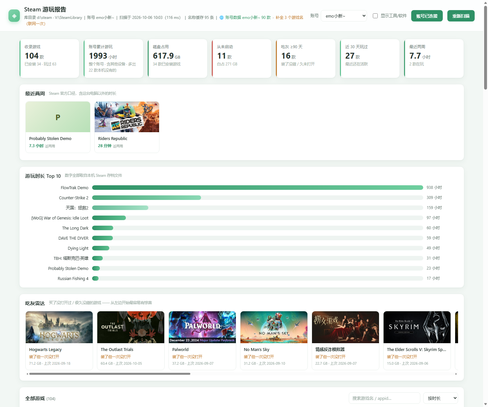
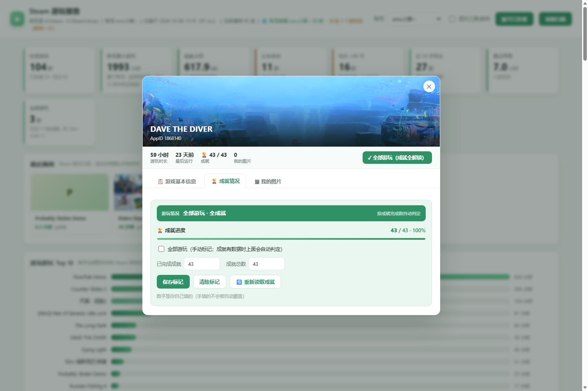
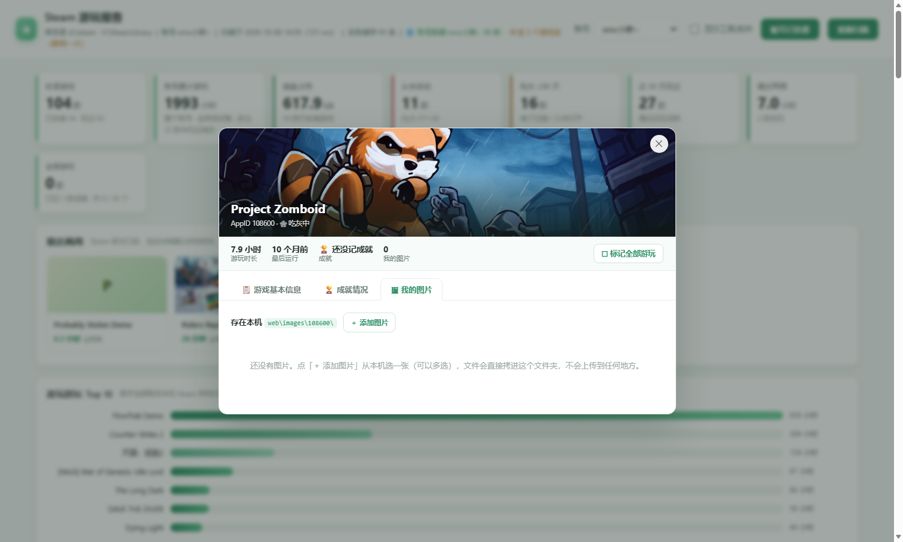

# Steam 游玩报告（本机版）

看一眼自己 Steam 库里到底发生了什么：**总共肝了多少小时、哪些游戏买了没打开、哪些吃灰、盘被谁占满了。**

- 纯本地：只读你电脑上的 Steam 文件，**不登录、不改动任何东西、不上传**
- 只有一个 Python 文件 + 一个网页，没有第三方依赖（不需要 `pip install`）
- 默认地址 `http://127.0.0.1:8770/`，只有本机能访问
- （可选）填一个免费的只读 API Key，就能把「整个账号」的时长也拉进来对照 —— 见 [想连账号数据？](#想连账号数据跨设备时长)



---

## 怎么用

**双击 `run.bat`** 就行。它会自己找到 Python、扫描 Steam、然后弹出浏览器。

关掉那个黑色命令行窗口 = 退出程序。

> ⚠️ **别直接双击 `web\index.html`。** 那个页面本身不含数据 —— 数据是后台的小服务从 Steam 存档里读出来再喂给它的。
> 直接打开文件（浏览器地址栏是 `file:///...`）只会看到一片空白，页面这时会提示你改用 `run.bat`。
> 正确姿势永远是：双击 `run.bat`，或者浏览器访问 `http://127.0.0.1:8770/`。

> 需要 Python 3.8+（[下载](https://www.python.org/downloads/)，安装时勾上 *Add python.exe to PATH*）。
> Steam 装在哪儿是**自动找的**（先查注册表，再试几个常见路径），换台电脑也不用改配置。
> 要手动指定就加 `--steam-root "你的路径"`。

---

## 页面上有什么

| 区块 | 说明 |
|---|---|
| **统计卡** | 收录游戏数 / 累计游玩小时 / 磁盘占用 / 从未启动 / 吃灰 ≥90 天 / 近 30 天玩过（连上账号后还会多出「最近两周」） |
| **最近两周** | 只有连上账号才会出现：官方口径的最近两周时长，含这台电脑以外的设备 |
| **游玩时长 Top 10** | 时长排行，点任意一条看详情 |
| **吃灰雷达** | 「装了但一次没打开」+「90 天以上没碰过」，前者按体积从大到小排（越靠左越心疼） |
| **全部游戏** | 卡片墙，支持搜索、排序、筛选；**每张卡片下面都有一键「标记全部游玩」按钮**，右上角会显示 `✓ 全部游玩`、`📷 N` 徽章 |
| **详情弹窗** | 大图下面先是**快捷条**（时长 / 最后运行 / 成就 / 我的图片 + 一键标记），再分**三个标签页** |
| ↳ **📋 游戏基本信息** | 时长 / 最后运行 / 占用 / 安装目录 / 所在库 / 最近更新，附「启动游戏」「商店页面」按钮；连上账号后会多一栏「这台电脑 vs 整个账号」 |
| ↳ **🏆 成就情况** | **打开就自动从 Steam 读成就**，并按成就完成数**自动判定「游玩情况」**，见下面一节 |
| ↳ **🖼 我的图片** | 给这款游戏加自己的截图 / 封面 / 表情包，**只存在本机** |

筛选：全部 · 已安装 · 玩过 · 从未启动 · 吃灰 · 已卸载但玩过 ·（有记录才会出现）全部游玩 · 有成就记录
排序：按时长 · 按最近玩过 · 按占用空间 · 按最近更新 · 按名称 ·（有成就记录时出现）按成就完成度

> **成就和游玩情况是自动的**：连上账号后，**打开哪款游戏就自动去 Steam 读哪款的成就**（不用点任何按钮），
> 6 小时之内不会重复问同一个游戏。读到的数字只写进本机 `manual.json`。
> 只读「打开的」那一款、不一次拉全库，是因为官方接口限流，几百个请求很可能被掐。
>
> **「游玩情况」完全由成就完成数推出来**，不用手填：
>
> | 成就进度 | 游玩情况 |
> |---|---|
> | 全部解锁 | **全部游玩 · 全成就**（卡片上自动挂 `✓ 全部游玩` 徽章） |
> | ≥ 80% | 快全成就了 |
> | 1% ~ 79% | 还在推成就 |
> | 0% | 一个成就都还没解锁 |
> | 这游戏没有成就系统 | 显示「没有成就系统」，这时才需要手动标记 |
>
> 手动标记仍然保留（卡片墙每张卡下面的按钮、详情弹窗快捷条最右边的按钮），
> 给没有成就系统的游戏用；**手动填的数字不会被自动读取覆盖**。
> 想强制重读某一款，点成就卡里的 **「🔄 重新读取成就」**。



### 给游戏加自己的图片

在详情弹窗里点第三个标签页 **🖼 我的图片**：

- 点 **「＋ 添加图片」** 选一张或多张（png / jpg / gif / webp / bmp / avif，单张≤12 MB），
  文件直接拷进本机的 `web/images/<AppID>/`，**不会上传到任何地方**
- 点缩略图看原图（新标签页打开）；鼠标移到图上，右上角出现 ✕ 可以删掉
- 卡片墙上那张卡会多一个 `📷 N` 徽章，写着这款游戏存了几张



几个小细节：

- 右上角 **「显示工具/软件」** 关掉时，Steamworks 公共库、Wallpaper Engine、OBS、Lossless Scaling 这类非游戏会被藏起来（默认关）。
- 顶栏 **「补全 N 个游戏名（联网一次）」** —— 已卸载游戏在本地拿不到名字，点一下从 Steam 商店接口补全，结果缓存到 `cache/appinfo.json`，以后不再联网。
- 地址栏支持深链：`http://127.0.0.1:8770/#app=108600` 直接打开某款游戏的详情（加 `&tab=ach` 直接落在成就页），`#cfg` 直接打开账号设置。
- 游戏封面按需从 Steam CDN 加载；**断网会自动降级成配色块**，不影响使用。

---

## 想连账号数据？（跨设备时长）

本机文件只记录**这台电脑**跑过的时长。想知道「算上别的电脑、算上更早的年份，这个账号一共肝了多少」，
就得走 Steam 官方接口。点右上角 **「连接 Steam 账号」**，按弹窗里的三步走：

1. 打开 <https://steamcommunity.com/dev/apikey>（需要已登录 + 手机令牌）
2. Domain Name 随便填，比如 `localhost`，点 Register
3. 把拿到的 32 位 Key 填进去；SteamID 会自动带上当前账号的，也可以用自定义网址名

拿到 Key 之后会多出这些东西：

- 统计卡多一张 **「最近两周」**，另开一个「最近两周」横滑区，列出这两周在玩的游戏
- **「累计游玩」变成「账号累计游玩」** —— 口径从这台电脑变成整个账号
- 详情弹窗里每款游戏同时给出 **这台电脑 X 小时 / 账号 Y 小时**
- 只在别的设备上玩过的游戏也会出现在列表里

关于隐私，说清楚：

- **不需要、也不会要你的 Steam 密码**，API Key 是只读的
- Key 只写进本机这个文件夹里的 `config.json`，页面只显示打码后的样子（`0123…cdef`），不会把完整 Key 回传
- 随时可以在同一个弹窗里点「清除已存的 Key」，或者直接删掉 `config.json`
- 唯一的外部请求就是发给 `api.steampowered.com`，没有任何第三方

连不上时的常见原因：

| 现象 | 原因 |
|---|---|
| `API Key 无效（Steam 返回 401）` | Key 没复制完整，或者已经吊销 |
| `拿到的游戏列表是空的` | Steam → 隐私设置 → **游戏详情** 要设为「公开」 |
| `连不上 Steam` | 网络/代理问题 |

---

## 数据从哪来（全部只读）

| 文件 | 取什么 |
|---|---|
| `config/loginusers.vdf` | 账号昵称 |
| `steamapps/libraryfolders.vdf` | 所有游戏库位置（本机有两个库，只扫一个会漏掉大部分游戏） |
| `<库>/steamapps/appmanifest_*.acf` | 游戏名、安装目录、体积、上次更新时间、是否已安装 |
| `userdata/<账号>/config/localconfig.vdf` | **每款游戏的游玩时长和最后运行时间** |

上面这些是本机文件的全部来源。连上账号后还会额外读 `api.steampowered.com` 的
`IPlayerService/GetOwnedGames`（这是唯一的联网数据源，不连就完全不碰网络，除了下面那些按钮）。
`IPlayerService/GetRecentlyPlayedGames` 用来填「最近两周」，`ISteamUserStats/GetPlayerAchievements` 用来读成就
（**打开某款游戏时自动读那一款**，6 小时内不重复请求；点「🔄 重新读取成就」会强制再问一次）。
唯一会主动写网络的是顶部那个 **「补全 N 个游戏名」**（只用 `store.steampowered.com` 查名字，不涉及账号）。

---

## 已知限制（先说清楚，免得误会）

1. **数据范围 = 这些文件里有什么**：本工具默认不登录 Steam，读的就是这台电脑上 Steam 写下的存档，里面记多少就显示多少。别的设备上玩的、Steam 云端的历史，这些文件里本来就没有，不是被工具过滤掉了。
   （想连云端一起看，就填一个 API Key —— 见上面的「想连账号数据？」。）
2. **只有「最后一次运行时间」**：Steam 本地文件不保存逐次会话记录，所以做不了「每周玩了多少小时」这种曲线，只能告诉你「上次碰它是几号」。官方接口也只多给一个「最近两周」的总量，同样没有逐日曲线。
3. **时长含挂机**：像 `FlowTrak Demo` 这种 900+ 小时，多半是挂在后台没关，不是真玩。
4. **名字靠联网补**：已卸载游戏在本地没有名字，只能联网查；离线时显示 `AppID <数字>`。连上账号后，官方返回的名字会自动补进缓存。
5. 「已卸载但玩过」的游戏会一直留在列表里（时长记录还在），这样才看得出「钱花哪儿了」。
6. **账号时长会取「本机」和「官方」里更大的那个**：官方数据同步有延迟，离线玩的部分可能还没上传，所以两边的数字偶尔对不上，工具宁可显示大的。
7. **成就是「打开哪款读哪款」**：Steam 本地文件里根本没有成就记录，所以成就数和「游玩情况」都靠官方接口。连上账号后打开某款游戏就自动读那一款（6 小时内不重复问）；不一次拉全库是因为官方接口限流，几百个请求很可能被掐，而且只有带成就系统的游戏才有数据。没连账号、或者游戏没有成就系统时，仍然可以手动填。
8. **手动标记和图片都在你自己手里**：这些数据不属于 Steam，是我额外记的 —— 标记写在 `manual.json`，图片存在 `web/images/`。**删掉这两样东西就等于撤销**（游戏时长、名称那些会照常重新扫描出来）。图片也不占备份、不上传，随文件夹走。

---

## 文件结构

```
steam-play/
├─ run.bat            双击启动
├─ app.py             本地小服务（127.0.0.1:8770）
├─ steam_local.py     只读数据层：解析 VDF，可单独当命令行用
├─ steam_online.py    Steam 官方 Web API（可选，跨设备时长）
├─ config.json        存 API Key / SteamID（点了「连接账号」才会生成，可随时删）
├─ manual.json        存你手填的「全部游玩」和成就数（标过才会生成，可随时删）
├─ cache/
│  └─ appinfo.json    联网补到的游戏名缓存
├─ docs/              代码审查报告 / 接口测试报告（专家产出，纯文档）
└─ web/
   ├─ index.html
   ├─ style.css
   ├─ app.js          零依赖前端
   └─ images/
      └─ <AppID>/     你自己给这款游戏加的图（加过才会有）
```

`steam_local.py` 可以单独跑，用来排查数据问题：

```bash
python steam_local.py                    # 人看的文本报告
python steam_local.py --json             # 原始 JSON
python steam_local.py --account 1272272233
python steam_local.py --enrich --json    # 顺手联网补名字
```

---

## 常用参数

```bash
python app.py --port 9000          # 换端口
python app.py --no-browser         # 不自动开浏览器
python app.py --steam-root "C:\Program Files (x86)\Steam"
python app.py --account 1272272233 # 指定账号
python app.py --enrich             # 启动时就联网补全一次名字
python app.py --online             # 启动时就拉一次账号数据（需要先配好 Key）
```
